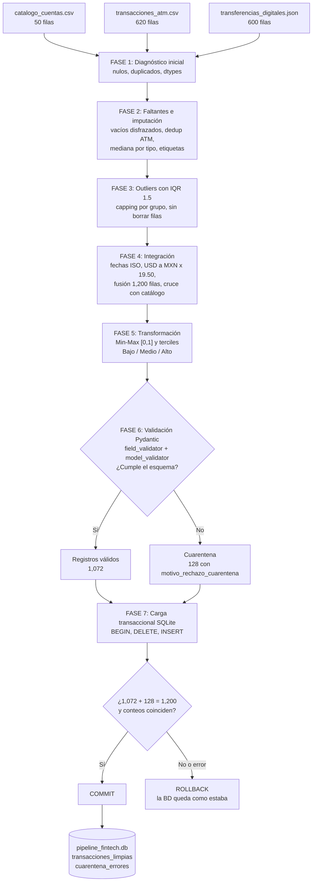

# REGLAS DE NEGOCIO Y JUSTIFICACIÓN TÉCNICA

**Proyecto Integrador: Pipeline ETL Robusto con Zona de Cuarentena**
Tecnológico Nacional de México, Instituto Tecnológico de Colima
Materia: Ingeniería de Datos (ATD-2602), Unidad 2
Docente: Armando Román Gallardo Heredia
Grupo 2 (LCNT): Fintech y Transacciones Bancarias (Cajeros ATM + SPEI / App)
Semestre Ago-Dic 2026

## 1. Equipo y roles

| Integrante                    | Rol             | Responsabilidad principal |
| ----------------------------- | --------------- | ------------------------- |
| Kevin Gilberto Borjas Ávalos | *fases 1 a 3* | Todo                      |
| Kevin Gilberto Borjas Ávalos | fases 4 a 5     | Todo                      |
| Kevin Gilberto Borjas Ávalos | fases 6 a 7     | Todo                      |

Referencia de roles: Ingeniero/a 1 = Calidad, nulos y outliers (Fases 1 a 3). Ingeniero/a 2 = Transformación e integración (Fases 4 y 5). Ingeniero/a 3 = Validación, resiliencia y BD (Fases 6 y 7).

## 2. Fuentes de datos

| Fuente                            | Formato | Filas | Columnas | Llave              |
| --------------------------------- | ------- | ----- | -------- | ------------------ |
| `catalogo_cuentas.csv`          | CSV     | 50    | 6        | `id_cuenta`      |
| `transacciones_atm.csv`         | CSV     | 620   | 8        | `id_transaccion` |
| `transferencias_digitales.json` | JSON    | 600   | 10       | `transfer_id`    |

## 3. Diagrama de flujo (mockup del pipeline)

Principio de diseño: ninguna fila se pierde en silencio. Todo registro termina en una de las dos tablas finales, y el control de integridad `válidos + cuarentena = recibidos` lo comprueba.

## 4. Reglas de negocio por fase

### Fase 1. Diagnóstico de calidad inicial

**Regla:** medir antes de transformar. Se calcula completitud (% de nulos por columna), unicidad (duplicados exactos y duplicados por llave) y dtypes inferidos.

**Justificación:** el diagnóstico inicial es el punto de comparación del reporte antes/después. Sin él no se puede demostrar cuánto mejoró la calidad.

**Hallazgos:** ATM con 20 duplicados exactos (también por llave `id_transaccion`); `monto_mxn` con 27 nulos (4.35 %) e `id_cajero` con 44 (7.1 %); `notification_email` con 8 nulos visibles.

### Fase 2. Faltantes e imputación

| Decisión                                                                         | Justificación                                                                                                                                                                                                                                                                                                                              |
| --------------------------------------------------------------------------------- | ------------------------------------------------------------------------------------------------------------------------------------------------------------------------------------------------------------------------------------------------------------------------------------------------------------------------------------------- |
| Normalizar `""` y `N/A` a nulo antes de contar                                | Pandas no los cuenta como nulos. Al normalizarlos, `notification_email` pasa de 8 a 16 nulos reales                                                                                                                                                                                                                                       |
| Eliminar los 20 duplicados del ATM **antes** de imputar (620 → 600)        | Los reintentos de cajero repiten montos y distorsionarían las medianas. Además cambia `id_cajero`, de 44 a 42 nulos                                                                                                                                                                                                                     |
| Clasificar faltantes como MCAR                                                    | Se calculó el % de nulos de `monto_mxn` por `tipo_operacion` y por `resultado`, y de `notification_email` por `platform`. Los porcentajes son bajos y parecidos entre categorías (por ejemplo 3.5 % a 6.1 % en `monto_mxn`, 1.8 % a 3.6 % en `notification_email`), sin un patrón que indique dependencia de otra variable |
| `monto_mxn`: imputar con **mediana por `tipo_operacion`**, no con media | La variable está muy sesgada a la derecha: media 9,527.40, mediana 1,500.00, máximo 3,500,000.00, asimetría 23.91. La media está inflada por pocos valores extremos                                                                                                                                                                     |
| `CONSULTA_SALDO`: monto = 0                                                     | Una consulta no mueve dinero. Es la regla de recálculo equivalente a `cantidad * precio_unitario` en estos datos                                                                                                                                                                                                                         |
| `id_cajero` nulo → `CAJERO_DESCONOCIDO`                                      | Etiqueta controlada: no se inventa un cajero                                                                                                                                                                                                                                                                                                |
| `notification_email` nulo → `ANONIMO`                                        | Etiqueta controlada que el validador de Pydantic acepta                                                                                                                                                                                                                                                                                     |
| **No** corregir emails malformados ni CLABEs de 5 dígitos aquí            | Son errores de formato, no faltantes. Se dejan para que Pydantic los desvíe a cuarentena con su motivo                                                                                                                                                                                                                                     |

### Fase 3. Outliers con IQR y capping

**Regla:** `IQR = Q3 - Q1`. Umbrales: `Q1 - 1.5·IQR` y `Q3 + 1.5·IQR`. Los valores fuera de umbral se recortan al umbral (winsorizing), no se eliminan.

| Decisión                                                          | Justificación                                                                                                                                                                        |
| ------------------------------------------------------------------ | ------------------------------------------------------------------------------------------------------------------------------------------------------------------------------------- |
| Capping en lugar de borrar filas                                   | La rúbrica pide no tener pérdida destructiva de datos válidos. Filas finales: ATM 600, digitales 600                                                                               |
| ATM: IQR **por `tipo_operacion` y sin `CONSULTA_SALDO`** | Los ceros de consulta no son datos reales y bajarían los cuartiles. Con un IQR global se recortarían 48 depósitos y pagos legítimos de 12,000, que es un valor normal y frecuente |
| Digitales: IQR **por moneda**                                | MXN y USD tienen escalas distintas y la conversión a pesos ocurre hasta la Fase 4                                                                                                    |
| Eliminar solo montos `<= 0` en operaciones que mueven dinero     | Es un valor imposible. Resultado: 0 registros eliminados                                                                                                                              |

**Resultado:** 19 valores recortados (1 en ATM, 15 en digitales MXN y 3 en digitales USD). La asimetría del ATM baja de 24.47 a 1.03 y la de digitales de 7.47 a 0.46. Cada recorte queda registrado con su valor original y su valor capeado en `outliers_detalle_recortes.csv`.

### Fase 4. Integración, unificación y huérfanos

| Decisión                                                                     | Justificación                                                                                                                                      |
| ----------------------------------------------------------------------------- | --------------------------------------------------------------------------------------------------------------------------------------------------- |
| Todas las fechas a ISO `YYYY-MM-DD` en hora local de Colima (UTC-6)         | Hay 5 formatos de entrada: 3 en ATM y, en el JSON, texto ISO con zona horaria y números epoch. Un solo formato permite ordenar y comparar          |
| `12/09/2026` se interpreta como **DD/MM/AAAA**                        | En el ATM, 77 fechas de ese tipo tienen un primer número mayor a 12 y ninguna tiene un segundo número mayor a 12. Por lo tanto no puede ser MM/DD |
| USD a MXN con tipo de cambio fijo **19.50**                             | Paridad oficial definida en los lineamientos. 134 importes convertidos. Se conservan `monto_original` y `moneda_original` para auditoría       |
| Fusión de ATM y digitales en una tabla de 1,200 filas, con columna `canal` | Un solo esquema común permite validar y cargar todo con las mismas reglas. Los textos se normalizan (`exitosa` → `EXITOSA`)                   |
| Cuentas que no existen en el catálogo: **marcar, no borrar**           | 61 huérfanas (32 ATM y 29 digitales, 5.08 %). Se marcan con `cuenta_huerfana` para que la Fase 6 las desvíe a cuarentena con su motivo          |

### Fase 5. Transformación

| Decisión                                                                              | Justificación                                                                                                                                                 |
| -------------------------------------------------------------------------------------- | -------------------------------------------------------------------------------------------------------------------------------------------------------------- |
| Min-Max sobre `monto_mxn` → `monto_mxn_norm`                                      | `(x - min) / (max - min)` lleva los montos a [0, 1]. Mínimo 0.00 → 0.0 y máximo 974,527.25 → 1.0                                                         |
| Discretización por **terciles** (percentiles 33.3 y 66.7) → `segmento_monto` | Cada segmento queda con 400 registros de 1,200 y no se inventan umbrales arbitrarios. Cortes: Bajo `<= 3,048.73`, Medio hasta `16,435.73`, Alto por encima |

### Fase 6. Validación con Pydantic y cuarentena

**Esquema `TransaccionLimpia`:**

| Tipo de regla        | Regla                                                                                                                                                     |
| -------------------- | --------------------------------------------------------------------------------------------------------------------------------------------------------- |
| Tipos y rangos       | Montos no negativos; estado dentro de los 7 valores conocidos; `monto_mxn_norm` entre 0 y 1                                                             |
| `@field_validator` | CLABE de exactamente 18 dígitos (46 casos de 5 dígitos); email válido o `ANONIMO` (30 malformados); cuenta existente en el catálogo (61 huérfanas) |
| `@model_validator` | `monto_mxn` coincide con el monto original por el tipo de cambio; un ATM trae cajero; una transferencia trae CLABE y correo                             |

**Cuarentena sin detener el lote:** cada fila se valida dentro de `try ... except ValidationError`. Si falla, se desvía a cuarentena y `motivo_rechazo_cuarentena` junta todos los motivos de esa fila. Un `except Exception` final evita que un error inesperado tumbe el pipeline.

**Resultado:** 1,200 recibidos = 1,072 válidos + 128 en cuarentena. Hay 8 registros con más de un motivo.

### Fase 7. Carga transaccional a base de datos

| Decisión                                                                                          | Justificación                                                                                                                         |
| -------------------------------------------------------------------------------------------------- | -------------------------------------------------------------------------------------------------------------------------------------- |
| Una sola transacción: `BEGIN`, `DELETE` de ambas tablas e `INSERT` de todo                  | Atomicidad: se carga todo o nada                                                                                                       |
| `commit()` solo si pasan las verificaciones de conteo                                            | Garantiza `válidos + cuarentena = recibidos`                                                                                        |
| Ante cualquier error, `rollback()`                                                               | La BD queda como estaba, sin cargas a medias                                                                                           |
| `DELETE` dentro de la transacción                                                               | El pipeline se puede re-ejecutar sin duplicar filas ni dar error de llave repetida. Si hay rollback, se conservan los datos anteriores |
| `PRIMARY KEY`, `NOT NULL` y `CHECK` (por ejemplo `cuenta_huerfana = 0`) en la tabla limpia | Segunda barrera de integridad, además de Pydantic                                                                                     |
| Cuarentena con casi todas sus columnas sin restricciones                                           | Ahí caen justamente los registros con datos malos. Solo se exige `motivo_rechazo_cuarentena`                                        |
| Columna `fecha_carga` en ambas tablas (UTC, la llena SQLite)                                     | Trazabilidad de cada carga                                                                                                             |

**Resultado:** `transacciones_limpias` con 1,072 filas, `cuarentena_errores` con 128 filas y `PRAGMA integrity_check` en `ok`.

## 5. Reglas de resiliencia

1. Ningún registro corrupto debe detener el lote: se desvía a cuarentena con su causa.
2. Todo error inesperado se captura (`except Exception`) y se registra, no se propaga.
3. La carga a BD es atómica: ante cualquier fallo se ejecuta `rollback()`.
4. El pipeline es re-ejecutable (idempotente): correrlo dos veces produce el mismo resultado.
5. Se verifican las pruebas de estrés con datos corruptos inyectados (montos negativos, CLABEs cortas, emails malformados, cuentas huérfanas y campos vacíos). Evidencia en `test_estres.py`.

## 6. Resumen de decisiones

| Tema                    | Decisión                               | Evidencia clave                                |
| ----------------------- | --------------------------------------- | ---------------------------------------------- |
| Imputación numérica   | Mediana por tipo de operación          | Media 9,527.40 vs mediana 1,500.00; skew 23.91 |
| Imputación categórica | `CAJERO_DESCONOCIDO` y `ANONIMO`    | 42 y 16 nulos a 0                              |
| Outliers                | IQR 1.5 con capping, por grupo          | 19 valores recortados, 0 filas perdidas        |
| Fechas                  | ISO, hora de Colima, DD/MM/AAAA         | 77 fechas con primer número mayor a 12        |
| Moneda                  | USD × 19.50                            | 134 importes convertidos                       |
| Huérfanos              | Marcar y desviar a cuarentena           | 61 de 1,200 (5.08 %)                           |
| Discretización         | Terciles                                | 400 registros por segmento                     |
| Validación             | Pydantic con cuarentena                 | 1,072 válidos + 128 cuarentena                |
| Carga                   | Transacción única con commit/rollback | Integridad `ok`                              |

## 7. Firmas de conformidad

Los integrantes declaramos que las decisiones anteriores fueron discutidas y aceptadas por el equipo.

| Nombre                        | Rol                | Firma  | Fecha      |
| ----------------------------- | ------------------ | ------ | ---------- |
| Kevin Gilberto Borjas Ávalos | ingeniero en jefe  | acepto | 25/10/2026 |
| Kevin Gilberto Borjas Ávalos |  ingeniero en jefe | acepto | 25/10/2026 |
| Kevin Gilberto Borjas Ávalos |  ingeniero en jefe | acepto | 25/10/2026 |
